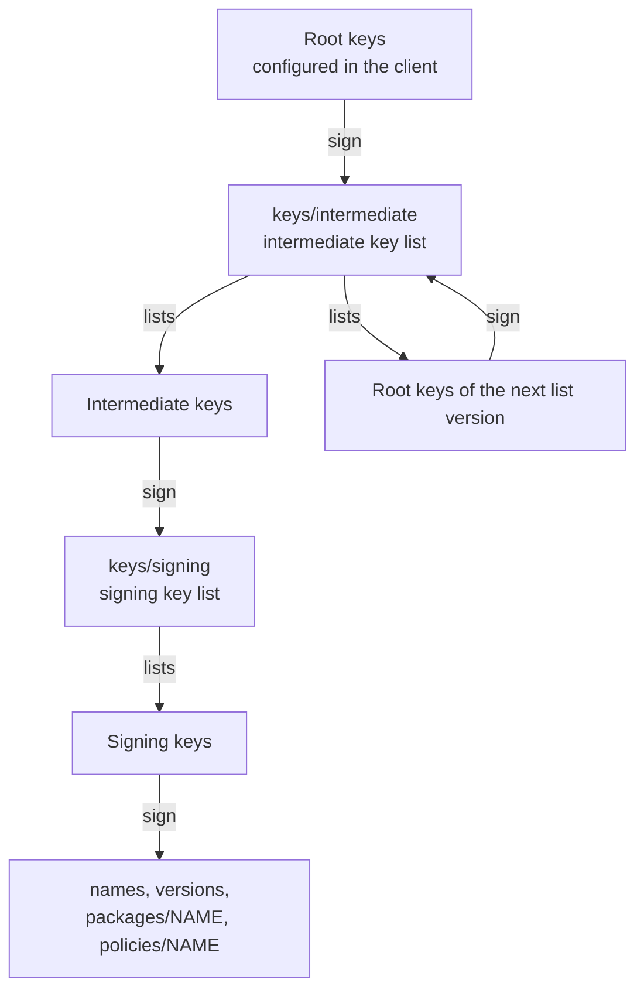
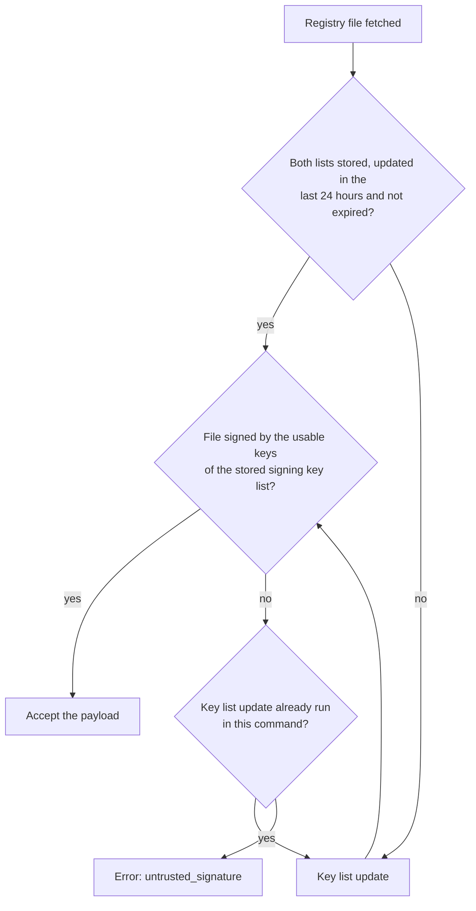

# Registry signing keys

The registry is signed with one RSA key whose public half is compiled into Hex, rebar3 and Gleam. Replacing it requires a release of every client. This design adds root keys that clients trust. A root key signs a list of intermediate keys, and an intermediate key signs a list of signing keys. The repository serves both lists as files next to the registry files. Once clients trust the root keys, hex.pm replaces a signing key or an intermediate key by publishing a new list. A root key can also hand trust to a new root key, so a planned root roll needs no client release. The `versions` file also gets an expiry, so a client can tell that the registry files it receives are current.

The names `SignedKeys`, `IntermediateKeys`, `SigningKeys` and "key list", the paths `keys/intermediate` and `keys/signing`, and the `expires_at` field of `Versions` are proposals.

## How it works today

- `Signed` in `registry/signed.proto` has `payload` (1) and `signature` (2). The signature is RSA PKCS#1 v1.5 with SHA-512 over `payload`.
- hexpm signs in `Hexpm.Repository.Storage.sign_and_gzip/1` with `HEXPM_SIGNING_KEY`, for `names`, `versions`, `packages/NAME` and `policies/NAME` of the `hexpm` repository and of every organization repository.
- hex_core verifies in `hex_registry:decode_and_verify_signed/2` with `repo_public_key`, which defaults to the key compiled into `hex_core.erl`. Hex compiles in its own copy in `Hex.Repo`. rebar3 vendors hex_core 0.20.1 with the key. Gleam compiles the key into `compiler-core/src/hex.rs` and verifies in `gleam-lang/hexpm-rust`.
- hexpm's `diff`, `preview` and `hexdocs` services depend on hex_core `~> 0.18.0` and use its default key.
- The Fastly edge decodes `Signed` in `fastly/hex-shared/src/policy.rs` to read a policy's visibility. It doesn't verify the signature.
- No registry payload says when it was built, and nothing ties a file to the current state of the registry. A mirror or proxy can serve an old, validly signed `packages/NAME` that lacks a release, a retirement or an advisory.

## Keys

There are three tiers.

The root keys are compiled into clients and sign only the intermediate key list. There are two root keys. Each one is generated on its own YubiKey 5 in a PIV slot and never leaves it. PIV attestation proves that the key was generated on the device. A different person holds each YubiKey, and the YubiKeys are offline except when a list is signed. One root signature is enough for a list, so losing one YubiKey leaves the other. The remaining root key and a replacement root key then sign a list that adds the replacement.

The intermediate key signs only the signing key list. It's a Cloud KMS HSM key in a Google Cloud project of its own, which no service account of the hexpm projects can access. A root key can replace it without a client release.

Signing keys sign registry files. A signing key is a Cloud KMS key in the hexpm project, and hexpm signs through the KMS API. The hexpm service account can sign with the key and can't export it. Someone who takes over hexpm can sign files only while they have access, and the KMS audit log records each signature. The intermediate key can replace a signing key without a YubiKey.

No private key of any tier can be exported. Clients learn the intermediate and signing public keys from the two lists.

All new keys are ECDSA P-256 with SHA-256. OTP's `public_key`, ring (which Gleam uses), Cloud KMS and YubiKey PIV support it, and a signature is about 70 bytes where RSA 2048 needs 256. Each key names its algorithm, so a later key can use a different one.

## Key list files

A repository serves the two lists as files, relative to the repository URL:

| Path | Content | Signed by | Valid for |
|---|---|---|---|
| `keys/intermediate` | The newest intermediate key list, a `SignedKeys` message | A root key | 12 months, re-signed every 6 |
| `keys/intermediate/VERSION` | The intermediate key list with that `version`. Never changes or disappears. | A root key | Not checked, see [Root key chain](#root-key-chain) |
| `keys/signing` | The newest signing key list, a `SignedKeys` message | An intermediate key | 30 days, re-signed every 7 |

The files are gzipped like registry files and need no authentication. Organization repositories of hex.pm use the files of the `hexpm` repository.

Registry files don't carry the lists. This has three effects:

- A re-signed list needs no rebuild of the registry files. That makes a short validity cheap.
- A client without stored state stops accepting a revoked signing key after 30 days at most, without a client release.
- A mirror or proxy must serve the key list files.

A scheduled job in the Google Cloud project of the intermediate key re-signs the signing key list every 7 days. It keeps the keys, increases `version` and sets a new `expires_at`. A change to the keys in the list is a manual step. The job makes the intermediate key an online key. Someone who takes over the job can sign a signing key list with a key of their own, until a root key revokes the intermediate key.

## Protobuf

```proto
syntax = "proto2";

message Signed {
  // Signed contents
  required bytes payload = 1;
  // RSA-SHA512 signature of the payload, for clients configured with a
  // single repository public key
  optional bytes signature = 2;
  // Signatures of the payload by signing keys listed in the signing
  // key list
  repeated Signature signatures = 3;
}

message Signature {
  // SHA-256 of the key's DER-encoded SubjectPublicKeyInfo
  required bytes key_id = 1;
  // For KEY_ALGORITHM_ECDSA_P256_SHA256, the DER-encoded Ecdsa-Sig-Value
  required bytes signature = 2;
}

// Content of the files keys/intermediate, keys/intermediate/VERSION and
// keys/signing
message SignedKeys {
  // Encoded SigningKeys or IntermediateKeys message
  required bytes payload = 1;
  repeated Signature signatures = 2;
}

message SigningKeys {
  // Increases with every new list
  required uint64 version = 1;
  // Unix time in seconds after which clients reject the list
  required int64 expires_at = 2;
  repeated Key signing_keys = 3;
}

message IntermediateKeys {
  // Increases by exactly 1 with every new list
  required uint64 version = 1;
  // Unix time in seconds after which clients reject the list
  required int64 expires_at = 2;
  repeated Key intermediate_keys = 3;
  // The root keys that clients trust after they accept this list
  repeated Key root_keys = 4;
}

message Key {
  // Clients skip a key whose algorithm is absent or unknown
  optional KeyAlgorithm algorithm = 1;
  // DER-encoded SubjectPublicKeyInfo
  required bytes public_key = 2;
  // Clients treat an absent or unknown status as KEY_REVOKED
  optional KeyStatus status = 3;
  // Unix time in seconds when a KEY_RETIRING root key stops signing
  // lists. Shown in the client's warning, not enforced by clients.
  optional int64 retires_at = 4;
}

enum KeyAlgorithm {
  // Clients skip the key
  KEY_ALGORITHM_UNSPECIFIED = 0;
  KEY_ALGORITHM_ECDSA_P256_SHA256 = 1;
}

enum KeyStatus {
  // Clients treat the key as KEY_REVOKED
  KEY_STATUS_UNSPECIFIED = 0;
  // Signatures by the key are accepted
  KEY_ACTIVE = 1;
  // Root keys only. Signatures by the key are accepted. A client with
  // no KEY_ACTIVE root key tells the user to update.
  KEY_RETIRING = 2;
  // Signatures by the key are rejected
  KEY_REVOKED = 3;
}
```

Each tier signs with its own prefix, so a signature made for one purpose can't verify for another:

- A signing key signs `prefix || payload`, with the prefix of the resource from the table below.
- An intermediate key signs `"hex-registry-signing-keys\n" || payload`, with the `payload` of the signing key list.
- A root key signs `"hex-registry-intermediate-keys\n" || payload`, with the `payload` of the intermediate key list.

A signing key uses one prefix per kind of resource:

| Resource | Payload | Prefix |
|---|---|---|
| `names` | `Names` | `"hex-registry-names\n"` |
| `versions` | `Versions` | `"hex-registry-versions\n"` |
| `packages/NAME` | `Package` | `"hex-registry-package\n"` |
| `policies/NAME` | `Policy` | `"hex-registry-policy\n"` |

A client verifies a file with the prefix of the resource that it requested. Protobuf decodes the bytes of one message as another message without an error, and `Names` and `Versions` have nearly the same fields. The prefix stops a repository or mirror from serving the signed file of one resource in the place of another.

A file can carry several signatures, one per signing key hexpm holds. This is how an algorithm change works: hexpm signs with a key of each algorithm and a client verifies the one it implements.

`KEY_RETIRING` on a root key tells users that a client update is coming. hex.pm publishes an intermediate key list that marks the old root keys as retiring with a `retires_at` date. A client released before the roll finds that none of its configured root keys is `KEY_ACTIVE`. After each key list update it prints a warning with the date and the update command. Clients don't enforce `retires_at`. The client keeps working after that date, because it follows the [root key chain](#root-key-chain) to the new root keys.

The enums are `optional` because protoc-generated proto2 parsers drop an unknown enum value, and a dropped `required` field fails the whole message. Value 0 of each enum is unspecified. A parser that substitutes the default for an absent or unknown value then skips the key or treats it as revoked.

Each signature adds about 110 bytes to a registry file before gzip: a 32-byte key ID, a signature of about 70 bytes and the field headers. A file has one signature, or two while a signing key is replaced.

## Client verification

A repository is configured with either root keys or a single public key. The built-in `hexpm` repository and hex.pm organization repositories use root keys. Repositories added with `mix hex.repo add --root-key PATH` use the given root key. Repositories added with `mix hex.repo add --public-key` keep the single key and today's check of field 2.

The rest of this section applies to a repository with root keys. For such a repository a client doesn't read field 2 and doesn't keep hex.pm's old RSA key. A client that accepted field 2 when field 3 is missing would accept files forged with the old key.

`HEX_UNSAFE_REGISTRY=1` and `repo_verify => false` skip all of it, as today.

### Overview



A client accepts a registry file only if it can follow these signatures from a root key that it trusts to the file. A client accepts a `packages/NAME` file only if it also matches a current `versions` file, see [Freshness](#freshness).

### Terms

The procedures below use these terms with one meaning each.

**Valid signature entry.** A `Signature` entry is valid for a key, a prefix and a payload if all of these are true:

- `key_id` equals the SHA-256 of the key's `public_key`.
- The client implements the key's `algorithm`.
- `signature` verifies over `prefix || payload` with that key and that algorithm.

An entry that isn't valid is ignored. It isn't an error, and the client continues with the next entry.

**Signed by a set of keys.** A message is signed by a set of keys if at least one of its `signatures` entries is valid for at least one key of the set. Nothing is signed by an empty set. The prefix and the payload depend on the message:

| Message | Prefix | Payload |
|---|---|---|
| Intermediate key list | `"hex-registry-intermediate-keys\n"` | `SignedKeys.payload` |
| Signing key list | `"hex-registry-signing-keys\n"` | `SignedKeys.payload` |
| Registry file | The prefix of the requested resource | `Signed.payload` |

**Usable key.** A root key is usable if its status is `KEY_ACTIVE` or `KEY_RETIRING`. An intermediate key or a signing key is usable if its status is `KEY_ACTIVE`. A key with any other status isn't usable. That includes an absent status and a status that the client doesn't know.

**Expired.** A list or a `versions` file is expired if its `expires_at` is lower than or equal to the client's current time.

**Error.** A procedure that raises an error stops. The command fails with a message that names the error. The client doesn't use or cache the file that caused the error, and its stored state stays as it was. [Errors and warnings](#errors-and-warnings) lists every error and the one case where an error becomes a warning.

A file that the client can't decode raises the same error as a file without a valid signature.

### Client state

| State | Scope | Start value |
|---|---|---|
| Configured root keys | Per repository | Compiled in, or given with `--root-key` |
| `root_version`: the `version` of the intermediate key list that the configured root keys come from | Per repository | Compiled in, or 0 for `--root-key` |
| Stored intermediate key list, in its signed form | Per set of configured root keys | None |
| Stored signing key list, in its signed form | Per set of configured root keys | None |
| Time of the last key list update | Per set of configured root keys | None |
| Highest accepted `expires_at` of `versions` | Per repository | None |
| Cached registry entries and their ETags | Per repository | None |

`hexpm` and every `hexpm:ORG` repository have the same configured root keys, so they share the stored lists. Hex keeps the state in its registry cache under `~/.hex`. hex_core takes the stored lists in its config and returns the lists it selected.

A client without stored state, such as a CI machine with an empty cache, starts every command with the start values.

If the stored intermediate key list has a `version` below `root_version`, the client deletes both stored lists before it does anything else. This occurs after a client upgrade.

The **trusted root keys** are:

- The usable keys in `root_keys` of the stored intermediate key list, if there is a stored list.
- The configured root keys, if there is none.

### Verifying a registry file



```
verify_registry_file(resource, signed):
    if lists_need_update() and not updated_in_this_command:
        update_key_lists()
    if signed_by_signing_key(resource, signed):
        return signed.payload
    if not updated_in_this_command:
        update_key_lists()
        if signed_by_signing_key(resource, signed):
            return signed.payload
    raise untrusted_signature

lists_need_update():
    return there is no stored intermediate key list
        or there is no stored signing key list
        or the last key list update is more than 24 hours ago
        or a stored list is expired

signed_by_signing_key(resource, signed):
    list = stored signing key list
    if there is no list or list is expired:
        return false
    return signed is signed by the usable keys in list.signing_keys
```

The second update covers a signing key that hex.pm added after the client's last update.

After `verify_registry_file` returns, the client decodes the payload and checks its `repository` and `name` fields, as today. For `versions` and `packages/NAME` the checks under [Freshness](#freshness) follow.

### Key list update

The update fetches both lists and replaces the stored ones only if both pass every check.

```
update_key_lists():
    updated_in_this_command = true
    try:
        intermediate = newest_intermediate_list()
        signing = newest_signing_list(intermediate)
    on error:
        if both lists are stored and neither is expired:
            warn with the error, and return
        raise the error

    revoked = the keys that are usable in the stored lists
              and aren't usable in intermediate and signing
    store intermediate, signing and the current time
    if revoked isn't empty:
        for every repository that uses these root keys:
            drop the cached entries, their ETags
            and the highest accepted expires_at
    if no configured root key is KEY_ACTIVE in intermediate.root_keys:
        warn root_keys_retiring

newest_intermediate_list():
    list = fetch keys/intermediate, or raise key_list_unavailable
    known = version of the stored intermediate key list, or root_version
    trusted = trusted root keys
    if list.version < known:
        raise key_list_rollback
    if list isn't signed by trusted:
        trusted = follow_root_key_chain(known, list.version, trusted)
        if list isn't signed by trusted:
            raise untrusted_key_list
    if list is expired:
        raise key_list_expired
    return list

newest_signing_list(intermediate):
    list = fetch keys/signing, or raise key_list_unavailable
    keys = usable keys in intermediate.intermediate_keys
    if list isn't signed by keys:
        raise untrusted_key_list
    stored = stored signing key list
    if stored is signed by keys and list.version < stored.version:
        raise key_list_rollback
    if list is expired:
        raise key_list_expired
    return list
```

The client sends the ETag of a stored list with the fetch. A `304` means that the fetched list is the stored one, and the checks run on it as on any other list.

A stored signing key list that isn't signed by a usable intermediate key doesn't count for the rollback check. This is the case after a root key revokes the intermediate key that signed it.

### Root key chain

Every intermediate key list with version N + 1 has these signatures:

- One by a root key that is usable in version N. A client that knows version N can then verify the list.
- One by a root key that the list itself marks `KEY_ACTIVE`. A client release that compiles in only the root keys of this list can then verify it.
- One by every root key that the list adds. This proves that the new key can sign before a later list depends on it.

One signature can meet more than one of these rules. Clients check only the first rule. The script that signs the list checks all three. The repository keeps every version at `keys/intermediate/VERSION`.

A client follows the chain if the newest list isn't signed by its trusted root keys. This occurs after a root roll, for a client that was released before the roll or that was offline during it.

```
follow_root_key_chain(known, newest, trusted):
    for version in known + 1, known + 2, ..., newest - 1:
        step = fetch keys/intermediate/VERSION, or raise key_list_unavailable
        if step.version != version:
            raise untrusted_key_list
        if step isn't signed by trusted:
            raise untrusted_key_list
        trusted = usable keys in step.root_keys
    return trusted
```

The client doesn't check `expires_at` of a step, because every list before the newest one is expected to be expired. It doesn't store a step. Only the newest list is stored, after it passes `newest_intermediate_list`.

A planned root roll therefore needs no client release, and a client of any age can reach the current root keys. The limit is a compromised root key. Someone who holds a root key that was usable at version N can forge a chain for every client whose known version is N or lower. Such clients need a release with new root keys and a higher `root_version`.

### Errors and warnings

| Name | Raised when | Result |
|---|---|---|
| `key_list_unavailable` | The client can't fetch a key list file. | See below |
| `untrusted_key_list` | A key list isn't signed by the keys that the client trusts for it, or a step of the root key chain has the wrong version. | See below |
| `key_list_rollback` | A key list has a lower `version` than the stored one, or than `root_version`. | See below |
| `key_list_expired` | A fetched key list is expired. | See below |
| `untrusted_signature` | A registry file isn't signed by a usable signing key, also after one key list update in this command. | The command fails. |
| `versions_expired` | `versions` is expired. | The command fails. |
| `versions_rollback` | `versions` has a lower `expires_at` than the highest accepted one, also after one new fetch. | The command fails. |
| `package_mismatch` | A package file doesn't match its entry in `versions`, also after one new fetch. | The command fails. |
| `root_keys_retiring` | No configured root key is `KEY_ACTIVE` in the stored intermediate key list. | Warning. The command continues. The message names `retires_at` and the update command. |

The four key list errors have one of two results. If both lists are stored and neither is expired, the client prints the error as a warning and continues with the stored lists. Otherwise the command fails, because the client has no list to verify a file with.

A message for `key_list_expired` or `versions_expired` names the expiry time and the local time, because a wrong clock causes the same error.

An unreachable repository isn't one of these errors. If the client can't fetch a registry file, Hex uses its cached entry, as today. Hex verified a cached entry when it fetched it, so it also keeps using the entry on a `304`, even if a stored list has expired since. After one of the errors above, the client doesn't use a cached entry in the place of the rejected file.

On upgrade, Hex drops the cached entries that an earlier release verified with the RSA key.

### What a revocation reaches

The stored versions stop a client from accepting an older list in which a revoked key is still active. A client with stored state learns of a revocation within 24 hours.

A client without stored state, such as a CI machine with an empty cache, fetches both lists on every run. Someone who controls the connection or the mirror can give it an older list until that list expires:

- A revoked signing key stays usable against such a client for 30 days at most.
- A revoked intermediate key stays usable against such a client for 12 months at most, or until the client is upgraded to a release with a higher `root_version`. After an intermediate key is compromised, the next release of each client raises that version.

An expired list makes every upgraded client fail on files it has to fetch. hexpm-ops alerts when the signing key list has less than 14 days left and when the intermediate key list has less than 90 days left.

## Freshness

The signatures above prove that hex.pm published a file. An expiry in `versions` proves that the file is current.

`Versions` gets one field:

```proto
message Versions {
  // All packages in the repository
  repeated Package packages = 1;
  // Name of repository
  required string repository = 2;
  // Unix time in seconds after which clients reject the file. A file
  // without the field doesn't expire.
  optional int64 expires_at = 3;
}
```

hexpm sets `expires_at` to 7 days ahead on every build of `versions`. Every change to a package builds the file. A job builds the `versions` file of every repository again once the file is older than 24 hours. hexpm never builds a `versions` file with a lower `expires_at` than the build before it.

`versions` lists the versions, the retired versions and the versions with advisories of every package. A client checks package files against it. For a repository configured with root keys, a client does this in every command that uses a `packages/NAME` file:

- It fetches `versions` one time and runs `verify_registry_file` and then `check_versions` on it.
- It runs `check_package` on every package file that it uses. That includes a cached entry after a `304`.

```
check_versions(repository, versions):
    highest = highest accepted expires_at of repository
    if versions has expires_at and versions is expired:
        raise versions_expired
    if there is a highest:
        if versions has no expires_at or versions.expires_at < highest:
            raise versions_rollback
    if versions has expires_at:
        store versions.expires_at as the highest accepted one

check_package(versions, package):
    entry = the entry in versions.packages with the name of package
    if there is no entry:
        raise package_mismatch
    if the versions of package.releases
            aren't the same set as entry.versions:
        raise package_mismatch
    if the versions of the retired releases of package
            aren't the same set as the versions at the indexes in entry.retired:
        raise package_mismatch
    if the versions of the releases of package with advisories
            aren't the same set as the versions at the indexes in entry.with_advisories:
        raise package_mismatch
```

`versions_rollback` and `package_mismatch` each allow one new fetch. The first time one of them is raised in a command, the client fetches `versions` and the package file again without ETags and runs the checks again. If the error is raised again, the command fails. The reasons are that two CDN nodes can serve different builds for a moment after a publish, and that a publish writes the two files one after the other.

A `versions` file without `expires_at` doesn't expire, and the client still runs `check_package` against it. Registries built with `mix hex.registry build` have no job that rebuilds them, so their files stay without the field. hex.pm sets the field from the first file that a new signing key signs. After a client has accepted that file, `check_versions` rejects every hex.pm file without the field.

The check has these limits:

- A mirror or proxy can hold a client at an old state of the registry for 7 days at most. It can't take a client back behind a state that the client has accepted. A client without stored state has no such protection.
- A change to a package file that leaves the three lists equal isn't detected. An example is a changed retirement message.
- `names` and `policies/NAME` aren't covered.
- A client whose clock is ahead of the expiry rejects the file.

Hex keeps using cached entries when the repository is unreachable, as today, also when its cached `versions` is expired.

A mirror serves `versions` as a normal file. It has to sync `versions` and the package files before the expiry, which is at least 6 days away. A caching proxy has to fetch `versions` again before the expiry.

The client fetches `versions` for every command that reads a package file. The size of that file for hex.pm and the cost of the fetch haven't been measured.

## Replacing keys later

A signing key is replaced with the intermediate key:

1. Create the new signing key in KMS. Sign and publish a signing key list that has both signing keys active.
2. Deploy hexpm so it signs with both keys. Rebuild every registry file and policy and purge the CDN.
3. Sign and publish a signing key list that marks the old key `KEY_REVOKED`. Deploy hexpm so it signs with the new key only.

A compromised key goes through the same three steps. A list that revoked the old key before step 2 finished would make every client that had stored it reject the files not yet rebuilt or still cached at the CDN.

The intermediate key is replaced the same way one tier up. A root key signs an intermediate key list with both intermediate keys active, and the new intermediate key signs the signing key list. Then a root key signs an intermediate key list that revokes the old intermediate key. Clients then drop every signing key list that only the old intermediate key signed. Neither step needs a rebuild.

A root key is replaced through the chain. An old root key and the new root key sign an intermediate key list that adds the new root key and marks the old one `KEY_RETIRING`. Client releases from then on compile in the new root keys. A later list marks the old root key `KEY_REVOKED`.

No client needs a release for any of these. [What a revocation reaches](#what-a-revocation-reaches) gives the limits for clients without stored state.

If one YubiKey is lost, the other root key and a replacement key sign a list that revokes the lost key and adds the replacement. If both YubiKeys are lost at the same time, nothing can sign the next intermediate key list, and every client needs a release with new root keys before the last list expires. A compromised root key also requires a release of every client with new root keys.

## Changes per repository

### specifications

`registry/signed.proto` and `registry/versions.proto` change as above. `registry-v2.md` gets the key list files, the verification steps and the freshness check. In `security/supply-chain/signing.md` the "Key Management" section is rewritten and the chain of trust comes off "Planned Improvements". The repository gets test vectors that every client implementation runs: a valid file, an expired list, a revoked key, a list with a lower version, a signature with the prefix of another tier, a signature with the prefix of another resource, a root key chain, an expired `versions` file, a `versions` file with a lower `expires_at` than an accepted one and a package file that doesn't match `versions`.

### hex_core

`hex_pb_signed` is regenerated. `hex_registry` signs with a list of signing keys, where a key is a private key or a function that signs. Its functions that sign and verify take the kind of resource. It builds and signs both lists and verifies as above. `hex_repo` fetches the key list files. `hex_core:default_config/0` replaces `repo_public_key` for hex.pm with the root public keys and their list version. Custom repositories are configured with root public keys or with `repo_public_key`. `hex_pb_versions` is regenerated, and `hex_registry` gets the check of a package file against `versions`.

### hex

Hex vendors the new hex_core, and `Hex.Repo` replaces `@hexpm_public_key` with the root keys. `Hex.Registry.Server` stores the lists, runs the key list update, drops cached entries as described under client verification, and prints the retiring warning. It fetches `versions` once per command, runs the freshness check and stores the highest `expires_at` that it has accepted per repository. It also gets error messages for an expired list, a revoked key, an expired `versions` file, a `versions` file that is older than an accepted one and a package file that doesn't match `versions`. `mix hex.repo add` and `mix hex.repo set` get `--root-key PATH`, which configures the repository with a root public key and can be given more than once. `mix hex.registry build` doesn't change.

### hexpm

`Storage.sign_and_gzip/1` signs through KMS with the configured signing keys, and fills field 2 from the old RSA key while one is configured. `HEXPM_SIGNING_KEY` becomes optional in `config/runtime.exs`. Development and test environments sign with a local key. A publish signs three files and a full rebuild signs every file. The latency per publish and the KMS quota for a rebuild haven't been measured.

At boot hexpm fetches both lists and checks that the signing key list verifies against the configured root public keys and lists every configured signing key as active. It refuses to start otherwise.

hexpm sets `expires_at` on every build of `versions`. A job builds the `versions` file of every repository again once the file is older than 24 hours.

A job rebuilds every registry file and policy of every repository and purges the CDN. The public keys page lists the root keys and the revoked RSA key. `diff`, `preview` and `hexdocs` get the new hex_core and keep the lists in memory.

### hexpm-ops

Terraform creates the signing key in KMS, with permission to sign for the hexpm service account and with data access audit logs. Terraform also creates the Google Cloud project and the KMS key for the intermediate key, and the scheduled job in that project that re-signs the signing key list. That job can write only the `keys/signing` object of the repository bucket. One script signs a changed signing key list with the KMS key, another signs an intermediate key list with a YubiKey and checks the signature rules of the root key chain. Both verify the result, upload it and purge the CDN. An alert fires when the signing key list has less than 14 days left, when the intermediate key list has less than 90 days left, or when a `versions` file has less than 5 days left. Staging gets its own root keys, intermediate key and signing key, and every step runs there first.

### Outside the hexpm organization

rebar3 vendors the new hex_core. Gleam needs the format, the key list update and the freshness check in `gleam-lang/hexpm-rust` and the root keys in the compiler. Mirrors and proxies must serve `keys/intermediate`, `keys/intermediate/VERSION` and `keys/signing`, and mirrors have to sync before `versions` expires. Caching proxies have to fetch `versions` again before it expires. Proxies that verify hex.pm's signature with the old key need the new format before the cutoff. Artifactory and Cloudsmith may be among them. Nobody has checked that, or whether they pass paths that they don't know.

## This rotation

1. Generate a root key on each YubiKey. Create the intermediate key and the new signing key in KMS. Sign intermediate key list version 1 with a root key and signing key list version 1 with the intermediate key.
2. Merge the specification and release hex_core with the root public keys.
3. Publish the key list files. Deploy hexpm so every file carries field 3, with field 2 still signed by the old RSA key, and `versions` carries `expires_at`. Run the rebuild job and confirm the CDN serves the new files and the key list files. Released clients keep working because they read only field 2.
4. Release Hex, rebar3 and Gleam with the root keys, and bump hex_core in `diff`, `preview` and `hexdocs`. These require field 3 and the key list files and check `versions`, so none of them ships before step 3 is confirmed. From their release on, upgraded clients reject files signed only with the old key.
5. Announce a cutoff date in the incident blog post and the user email.
6. At the cutoff, deploy hexpm without the old key and run the rebuild job. After no SecretSync resource, Pod or Job template references `hexpm-signing-key` version 1, destroy that version. Field 2 is then 256 zero bytes, which released clients reject through their ordinary bad-signature path. An absent field 2 would crash released hex_core on a failed map match in `decode_and_verify_signed/2`.

At the cutoff a released client fails on files it has to fetch. Hex prints its existing signature error, which points at https://hex.pm/docs/public_keys. Released Hex with a cached entry for a package prints "Failed to fetch record" and continues on the cached data (`Hex.Registry.Server.write_result/4`), so a project with a lock file and a warm cache keeps building until it needs a package or version it hasn't cached.

Clients that are never upgraded keep accepting signatures from the old key for as long as they run. Users on Elixir versions older than Hex main supports (`~> 1.12`) can only continue with `HEX_UNSAFE_REGISTRY=1`.
